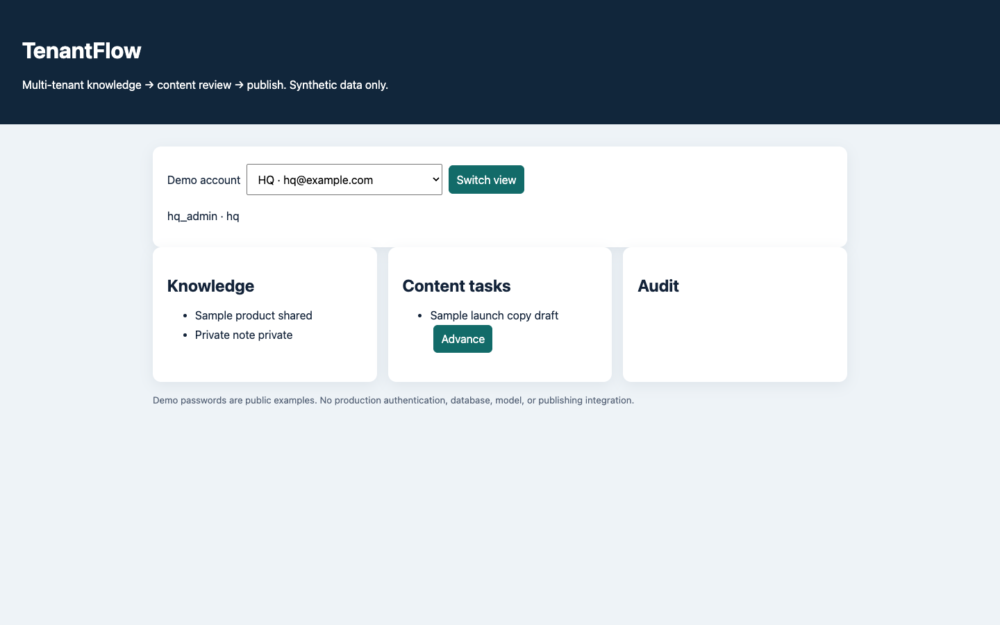
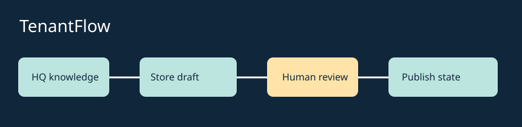

# TenantFlow · multi-tenant AI workflow SaaS

**总部发下来的资料，门店能看哪些？谁能审核，谁能发布？** TenantFlow 把这三个决定做进同一条可追踪链路：租户过滤、共享资料继承、审核状态和操作审计。适合看一个工作流如何处理“谁能看、谁能改”，而不仅是展示页面。

*Tenant-scoped knowledge, human review, and a local HTTP workflow with restart and rollback tests.*

[打开在线演示](https://zhouey314-cloud.github.io/multi-tenant-ai-workflow-saas/) · [HTTP、事务与失败契约](docs/HTTP_API.md) · [策略 core](src/core.js) · [真实服务回归](tests/server.test.ts) · [案例](docs/case-study.md) · [简历](docs/resume-bullets.md) · [面试复盘](docs/interview-notes.md)

| 想验证什么 | 从哪里做 |
| --- | --- |
| 总部私有资料不该出现在门店 | [打开演示](https://zhouey314-cloud.github.io/multi-tenant-ai-workflow-saas/)，按下方三个场景切角色；先对比私有和共享资料，再查看审核后的审计记录 |
| 提交后可重启读取，失败不留下幽灵任务 | Node 24 下运行 `npm test`；[HTTP 测试](tests/server.test.ts)以临时存储覆盖写盘故障、回滚以及重启 |
| 页面角色规则与文档是否一致 | [固定提交的 CI](https://github.com/zhouey314-cloud/multi-tenant-ai-workflow-saas/actions/runs/40997968780)运行 `npm run check:docs`，校对文档和核心规则测试；不等于它执行了全部 HTTP 测试 |

**边界：**公开版是浏览器里的虚构数据与演示登录；本地版是单进程监听回环地址的 JSON 存储。二者均不能代替生产 IAM，不连接模型、真实租户或发布系统。

**Status:** interactive synthetic browser demo · policy tests 11/11 · no production authentication or model integration.

> Independent clean-room portfolio demo. Synthetic organizations, knowledge and content. No company source, UI or customer data.

## Demo

**Live Demo:** <https://zhouey314-cloud.github.io/multi-tenant-ai-workflow-saas/>. It runs in your browser using the same `src/core.js` policy functions as the local API. Data is synthetic, persists only in that browser, and can be reset at any time. Demo logins: `hq@example.com` / `demo-hq-only`, `store@example.com` / `demo-store-only`, `review@example.com` / `demo-review-only`. These public passwords are role selectors, **not security controls**.

Local: Node 24 LTS, `npm test`, then `npm start` and open <http://localhost:8788>.

### Try these scenarios

1. HQ creates private knowledge → switch to Store: it is hidden.
2. HQ creates shared knowledge → switch to Store: it is visible and usable as grounding.
3. Store creates a draft and submits it → Reviewer approves or rejects → HQ can publish an approved task. Inspect the who/when/action/entity audit; then click **Reset Demo Data**.

## Problem and design

Show how enterprise knowledge can flow from HQ to a store while private items remain isolated and content passes a human review gate. [Architecture, data model, RBAC and state machine](docs/architecture.md) describe each permission. `src/core.js` is the single policy source for both `src/server.ts` and `web/app.js`; the latter is deployed statically on GitHub Pages. Local API JSON storage and browser localStorage are separate demo adapters.

## Features and verification

Tenant filtering, parent to child shared knowledge, private records, task transitions, audit trail, synthetic seed and eleven offline tests. The baseline was 7/7; the V3 suite is 11/11 with HQ/store visibility, explicit reject, audit isolation and rejection of unknown roles or mismatched tenant units. These are deterministic mechanics checks, not a model eval or security certification. No AI provider is connected; task generation is a workflow placeholder. Run `npm test`; `npm run check:docs` checks README, case-study, interview and resume claims against the actual core test results. See [resume bullets](docs/resume-bullets.md) and [interview notes](docs/interview-notes.md).

## Status and limitations

`IMPLEMENTED_AND_TESTED` for the shared policy, browser interactions and state machine. `MOCK` for login and seed. `NOT_IMPLEMENTED` for real authentication, Postgres, external AI, email and publishing. The browser downloads the synthetic dataset; its role filters demonstrate policy behavior but do **not** secure real confidential data. Do not use this demo for real tenants. Production roadmap: authenticated sessions, transaction-scoped tenant filtering, row-level security, migration tests, immutable audit and human-approved provider evaluations.

## Security and privacy

All identities and content are fabricated. The local API binds to `127.0.0.1`; the online demo is a static browser app with public seed data and localStorage. Neither should hold sensitive data. MIT license.
